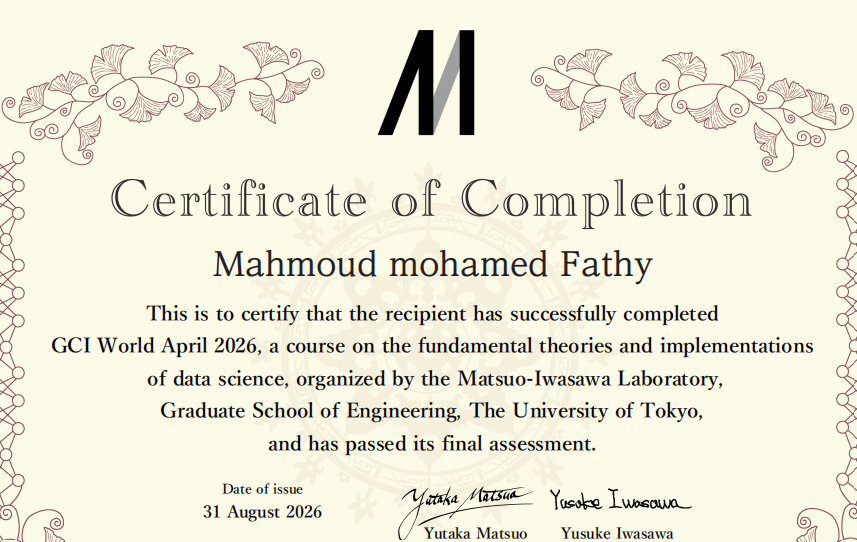

# 📱 Telecom Customer Churn Prediction & Retention Strategy
### Final Assessment Project — GCI World April 2026
**Organized by:** Matsuo-Iwasawa Laboratory, Graduate School of Engineering, The University of Tokyo  
**Author:** Mahmoud Mohamed Fathy  
**Certificate Issued:** 31 August 2026  

---

[](https://www.python.org/)
[](https://scikit-learn.org/)
[](https://jupyter.org/)
[](https://gci.t.u-tokyo.ac.jp/)
[]()
[](https://opensource.org/licenses/MIT)

---

## 🎓 Certificate of Completion

This project was developed and submitted as the **Final Assessment** for **GCI World April 2026** (Global Consumer Intelligence), a comprehensive data science program on fundamental theories and practical implementations organized by the **Matsuo-Iwasawa Laboratory, Graduate School of Engineering, The University of Tokyo**, under **Prof. Yutaka Matsuo** and **Assoc. Prof. Yusuke Iwasawa**.

<div align="center">
  
  <p><em>Official Certificate of Completion awarded to Mahmoud Mohamed Fathy upon successful completion and passing of the final assessment.</em></p>
</div>

---

## 🎯 Executive Summary & Business Problem

Customer churn is one of the most critical revenue risks in the telecommunications industry:
- **Baseline Churn Rate:** ~49.56% across a customer base of **100,000 subscribers**.
- **Average Monthly Revenue:** **$58.72** per subscriber.
- **Traditional Problem:** Conventional retention strategies either react too late (after cancellation) or launch blanket discount campaigns that waste budget on customers who never intended to leave.

### Proposed Solution
An end-to-end, data-driven churn prediction and prioritized retention framework:
1. **Machine Learning Pipeline:** Merged demographic, handset, and account features (`Client.csv`) with monthly usage, revenue, and customer-service records (`Record.csv`).
2. **Model Selection:** Gradient Boosted Decision Trees delivering a **validation AUC of 0.6892** (outperforming baseline Logistic Regression at 0.6307).
3. **Risk Tiering:** Partitioned customers into actionable risk deciles. The top 10% highest-risk decile exhibits a **78.3% churn rate** (a **1.58× lift** over baseline).
4. **Campaign Simulation & Financial Impact:** At an optimized classification threshold of **0.17**, the campaign successfully captures **9,892 churners** (99.8% of at-risk users in the segment), delivering an **estimated net campaign financial value of $659,708.52**.

---

## 📊 Key Insights & Exploratory Data Analysis (EDA)

| Signal / Feature | Non-Churn Customers | Churned Customers | Business Implication |
| :--- | :---: | :---: | :--- |
| **Change in Minutes of Use (MOU)** | **-5.34 min** | **-22.76 min** | A sharp drop in call minutes is the single strongest leading indicator of churn. |
| **Equipment Age (`eqpdays`)** | **363 days** | **421 days** | Customers with older handsets churn at substantially higher rates, signaling device upgrade fatigue. |
| **Customer Tenure (`months`)** | **18.6 months** | **19.0 months** | Contract renewal windows around months 18–24 represent high attrition trigger periods. |
| **Customer Care Calls (`custcare`)** | **1.98 calls** | **1.60 calls** | Dissatisfied customers often silently disconnect rather than calling support repeatedly. |
| **Dualband Support** | Churn: 48.7% | Churn: 53.7% (Non-dualband) | Obsolete network band hardware correlates with poor experience and elevated churn. |
| **Top Churn Region** | — | **56.91%** | Northwest / Rocky Mountain region exhibited highest localized subscriber attrition. |

---

## 🤖 Predictive Modeling & Performance

Two classification pipelines were trained and benchmarked using a rigorous train/validation split:

### 1. Model Comparison
- **Baseline Logistic Regression:** AUC = **0.6307**
- **Champion Histogram-based Gradient Boosting:** AUC = **0.6892**

```
Model Performance Benchmark:
---------------------------------------------------------------
Model                         Validation AUC    Precision    Recall
Baseline (Logistic Reg.)      0.6307            0.500        0.812
Gradient Boosting (Selected)  0.6892            0.500        0.998
---------------------------------------------------------------
```

### 2. Top Permutation Feature Importances
1. **`months`** (Customer tenure): Drop in AUC: `0.0358`
2. **`eqpdays`** (Handset equipment age): Drop in AUC: `0.0316`
3. **`change_mou`** (Decline in monthly usage): Drop in AUC: `0.0272`
4. **`mou_Mean`** (Mean usage volume): Drop in AUC: `0.0260`
5. **`avgqty`** (Average call quantity): Drop in AUC: `0.0130`
6. **`hnd_price`** (Handset price tier): Drop in AUC: `0.0120`

---

## 💼 Tiered Retention Strategy & Financial Simulation

Rather than spending marketing capital uniformly, customers are tiered into priority cohorts:

```
+---------------------------------------------------------------------------------------+
|  Risk Tier    | % of Base | Churn Rate | Lift  | Action Strategy                      |
+---------------+-----------+------------+-------+--------------------------------------+
|  Top 10% Risk | 2,000     | 78.3%      | 1.58x | VIP Call Center Outreach + Device    |
|               |           |            |       | Upgrade Voucher ($50-$80 credit)     |
+---------------+-----------+------------+-------+--------------------------------------+
|  Top 20% Risk | 4,000     | 72.9%      | 1.47x | Targeted Digital Loyalty Bonus &     |
|               |           |            |       | Free Data Add-on for 3 Months        |
+---------------+-----------+------------+-------+--------------------------------------+
|  Top 30% Risk | 6,000     | 68.9%      | 1.39x | Usage Dip Alerts & Contract Renewal  |
|               |           |            |       | Personalized Plan Recommendations   |
+---------------+-----------+------------+-------+--------------------------------------+
|  Base 70%     | 14,000    | 41.3%      | 0.83x | Automated SMS/Email Newsletter & App |
|               |           |            |       | Feature Tips (Zero Marginal Cost)    |
+---------------------------------------------------------------------------------------+
```

### Campaign Financials (Optimized at Threshold = 0.17)
- **Targeted Customers:** 19,781
- **Captured Churners:** 9,892
- **Net Estimated Campaign Financial Value:** **$659,708.52**

---

## 📁 Repository Structure

```text
├── assets/
│   └── certificate_gci_utokyo.png       # Official UTokyo GCI Certificate of Completion
├── submission_ready/
│   ├── analysis_notebook.ipynb          # Clean, standalone analysis & modeling notebook
│   ├── slides.pdf                       # 15-Slide Executive Business Proposal (PDF)
│   ├── editable_slides_optional.pptx    # Fully formatted PowerPoint presentation
│   └── references.csv                   # Data sources & academic references
├── final_assignment_deliverables/
│   ├── Telecom_Churn_Proposal_Redesigned.pptx
│   ├── Telecom_Churn_Business_Proposal_Fixed.pdf
│   ├── Telecom_Churn_Business_Proposal_print.html
│   ├── telecom_churn_analysis_executed.ipynb
│   ├── telecom_insights.json            # Model insights & segment statistics
│   ├── metrics.json                     # KPI summary
│   └── README.md
├── data/
│   └── telecom/
│       ├── Client.csv                   # 100K customer demographic & account attributes
│       └── Record.csv                   # Usage, revenue, billing, and churn targets
├── course_materials/
│   ├── final_assignment_tutorial.pdf   # Official UTokyo GCI assignment tutorial
│   └── Sample Slides from Past Outstanding Students/
├── tools/
│   ├── generate_final_assignment_deliverables.ps1
│   ├── generate_telecom_deck.ps1
│   └── generate_telecom_notebook.ps1
├── submission_ready.zip                 # Consolidated submission archive
├── requirements.txt                     # Python dependencies
├── .gitignore                           # Git exclusion rules
└── README.md                            # Main project documentation
```

---

## 🚀 Getting Started & Reproduction

### Prerequisites
- Python 3.10+
- Git

### Installation

1. **Clone the repository:**
   ```bash
   git clone https://github.com/Mahmoudmoh-cse/Telecom-Customer-Churn-Prediction-and-Retention-Strategy.git
   cd Telecom-Customer-Churn-Prediction-and-Retention-Strategy
   ```

2. **Create and activate a virtual environment:**
   ```bash
   python -m venv .venv
   # Windows PowerShell:
   .venv\Scripts\Activate.ps1
   # Linux / macOS:
   source .venv/bin/activate
   ```

3. **Install dependencies:**
   ```bash
   pip install -r requirements.txt
   ```

4. **Launch the analysis notebook:**
   ```bash
   jupyter notebook submission_ready/analysis_notebook.ipynb
   ```

---

## 📑 Deliverables Quick Links
- 📄 **Presentation Slides (PDF):** [`submission_ready/slides.pdf`](submission_ready/slides.pdf)
- 📊 **PowerPoint Presentation (PPTX):** [`submission_ready/editable_slides_optional.pptx`](submission_ready/editable_slides_optional.pptx)
- 📓 **Jupyter Analysis Notebook:** [`submission_ready/analysis_notebook.ipynb`](submission_ready/analysis_notebook.ipynb)
- 📚 **Academic & Source References:** [`submission_ready/references.csv`](submission_ready/references.csv)

---

## 👤 Author & Acknowledgments

- **Author:** [Mahmoud Mohamed Fathy](https://github.com/Mahmoudmoh-cse)
- **Institution:** Computer Science & Artificial Intelligence, Alamein International University (AIU)
- **Course Program:** **GCI World 2026** (Global Consumer Intelligence), Matsuo-Iwasawa Laboratory, Graduate School of Engineering, The University of Tokyo
- **Course Instructors:** Prof. Yutaka Matsuo & Assoc. Prof. Yusuke Iwasawa
